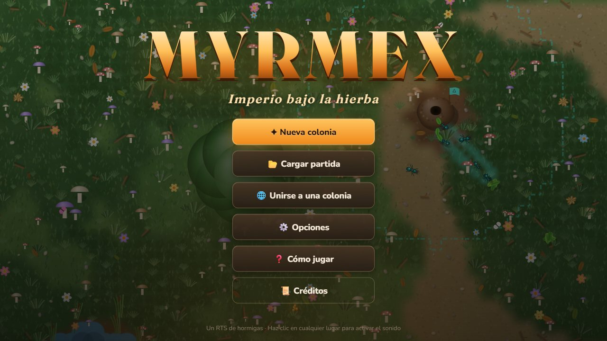
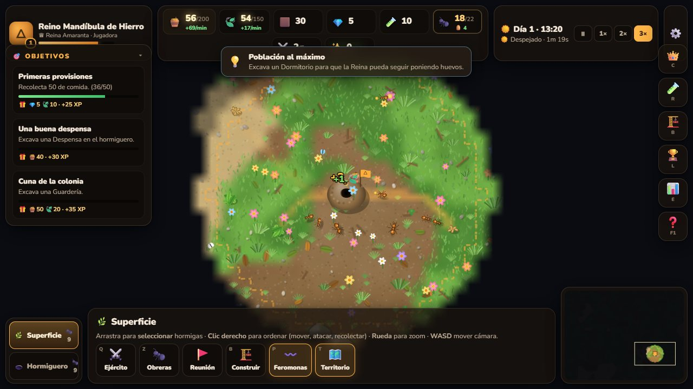
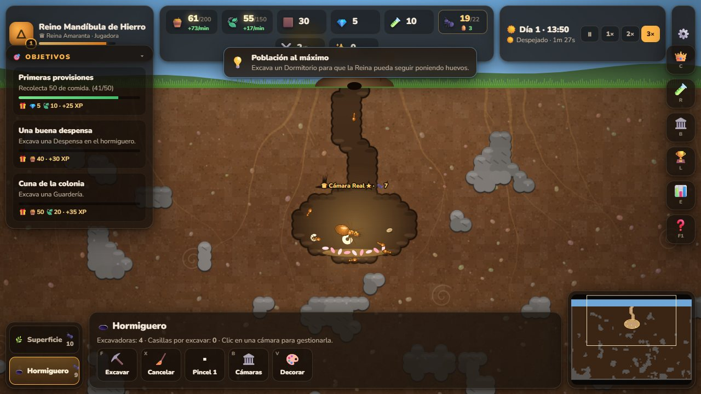
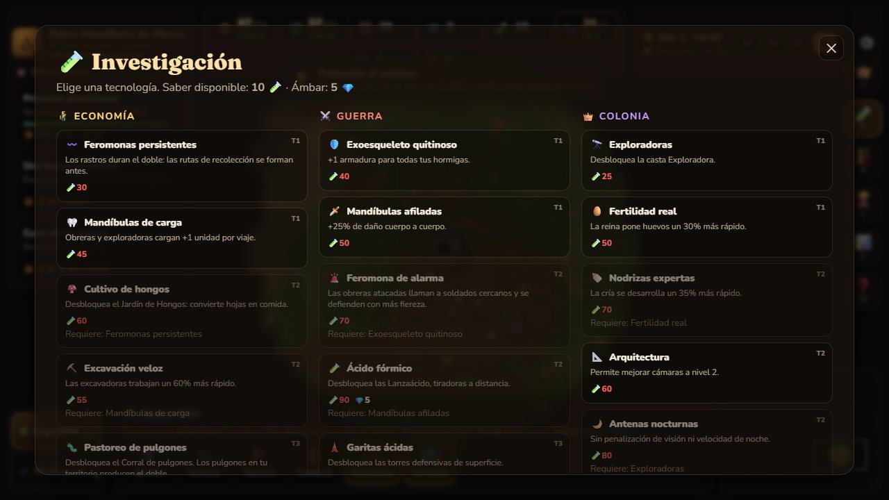

<p align="center"><a href="README.md">Español</a> · <b>English</b></p>

<div align="center">

# MYRMEX — Empire Beneath the Grass

**An ant-colony RTS for the browser.**
Dig tunnels, raise castes, research, expand your territory and defeat the rival colonies.

[](https://virtuanista.github.io/myrmex/)




</div>

## Contents

- [Screenshots](#screenshots)
- [How to play](#how-to-play)
- [Controls](#controls)
- [What's in the game](#whats-in-the-game)
- [Online co-op](#online-co-op-2-players)
- [Technical notes](#technical-notes)
- [Development](#development)
- [License](#license)

## Screenshots

| | |
|---|---|
|  |  |
| **The surface**: gathering, pheromones and territory | **The anthill**: dig chambers and take care of the Queen |


<p align="center"><b>Research</b>: 28 technologies in three branches (Economy, War and Colony)</p>

## How to play

- **In the browser:** go to **[virtuanista.github.io/myrmex](https://virtuanista.github.io/myrmex/)**. It works in Chrome, Edge and Firefox, and co-op works from there too.
- **Offline:** the whole game is a single HTML file. Save the page from the link above (Ctrl + S), or build it with `npm run build` and double-click `dist/index.html`.

The game saves itself to the browser's local storage: every minute, at dawn and when you close the tab.

## Controls

| Action | Key / mouse |
|---|---|
| Select | Drag with left click · double click: all of the same caste |
| Give orders (move, attack, gather, build) | Right click · Shift + right click: patrol |
| Camera | WASD / arrow keys / screen edge / wheel (zoom) / middle button |
| Surface ↔ anthill | Tab |
| Colony · Research · Build · Achievements · Statistics | C · R · B · L · E |
| Army / visible workers | Q / Z |
| Stop / return | X / H |
| Groups | Ctrl + 1…9 to create · 1…9 to select (double press: center) |
| Anthill: dig / cancel / decorate | F / X / V |
| Pause · speed · quick save | Space · `,` `.` · F5 |

## What's in the game

- **7 castes** and the Queen: Obrera (Worker), Exploradora (Scout), Cortadora (Cutter), Soldado (Soldier), Lanzaácido (Acid Thrower), Coloso (Colossus) and Princesa alada (Winged Princess).
- **9 chamber types** with 3 levels, 12 decorations that grant prestige, 4 surface buildings and satellite nests.
- **28 technologies** in 3 branches, 34 chained objectives, 24 achievements and colony levels.
- **10 creature species**, bosses included, 12 events, a day and night cycle, and weather.
- **Rival AI** that grows, expands, launches raids and also fights the other colonies.
- **Pheromones and emergent paths**: trails get stronger with use, and gathering routes appear on their own.

## Online co-op (2 players)

1. **Host:** in the game, pause menu → **Invitar a una amiga** (Invite a friend) → copy the code.
2. **Guest:** main menu → **Unirse a una colonia** (Join a colony) → paste the code → copy the reply.
3. **Host:** paste the reply → **Conectar** (Connect).

The connection is P2P over WebRTC, with public STUN servers and no server of its own: you exchange the codes by hand over whatever chat you prefer. The host simulates the world, the guest receives compressed snapshots (~40 KB/s), and the guest's orders are carried out in the host's game. There is chat with Enter and map pings with Alt + click.

> Very restrictive networks (symmetric NAT) may prevent the connection.

## Technical notes

- **Zero external assets**: all the art (grass, flowers, ants, tunnels…) is drawn from code with Canvas 2D, and all the sound is synthesized with Web Audio. You can listen to an [audio sample](docs/muestra-audio.webm).
- **A single file**: `vite-plugin-singlefile` packs the whole game into one `index.html`, which works even when opened from disk.
- **No server for multiplayer**: WebRTC signaling is done by copying and pasting codes, so co-op works just the same from GitHub Pages.
- **Seeded world**: each game is generated from a seed you can choose or share.

## Development

You need [Node.js](https://nodejs.org) 20 or later.

```bash
npm install
npm run dev     # http://127.0.0.1:4747
npm run check   # type checking
npm run build   # generates dist/index.html
```

The web version is published on GitHub Pages from the `gh-pages` branch, which contains the built `dist/`.

| Folder | Contents |
|---|---|
| `src/core/` | Event bus and utilities |
| `src/game/` | Simulation: state, ants, colony, nest, combat, creatures, rival AI, missions and saving |
| `src/render/` | Procedural drawing of the surface and the anthill |
| `src/audio/` | Effect and music synthesis |
| `src/ui/` | HUD, menus and input |
| `src/net/` | Co-op over WebRTC |

## License

Original code, art and audio, released under the [MIT](LICENSE) license.

<p align="center">
	Repository made by <a href="https://github.com/virtuanista" target="_blank">virtu 🎣</a>
</p>

<p align="center">
	
</p>

<p align="center">
	Copyright &copy; 2026
</p>

<p align="center">
	<a href="LICENSE"></a>
</p>
