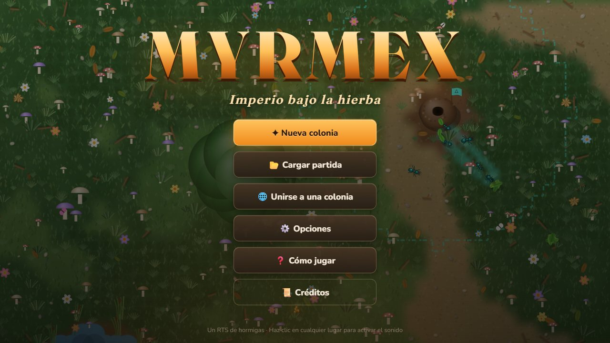
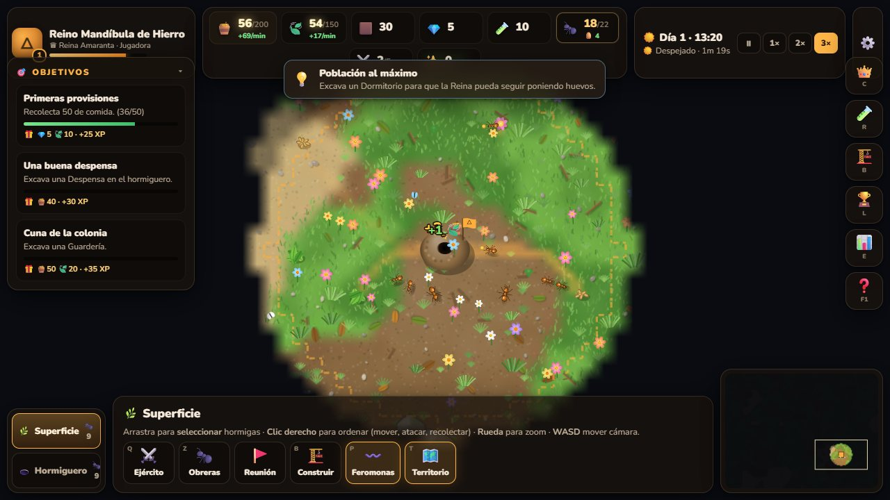
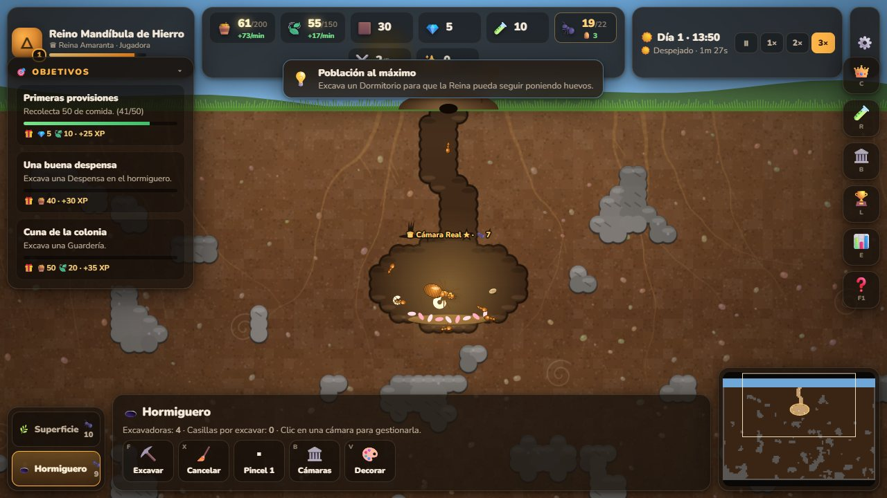
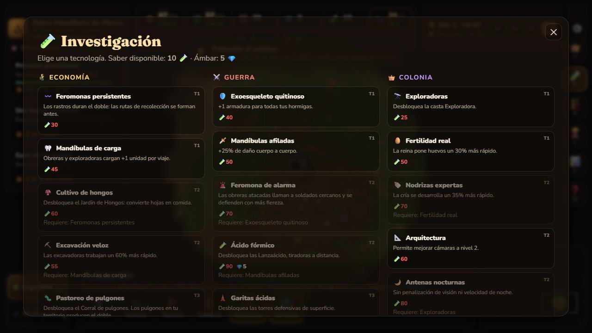

<p align="center"><b>Español</b> · <a href="README.en.md">English</a></p>

<div align="center">

# MYRMEX — Imperio bajo la hierba

**Un RTS de colonias de hormigas para el navegador.**
Excava túneles, cría castas, investiga, expande tu territorio y derrota a las colonias rivales.

[](https://virtuanista.github.io/myrmex/)




</div>

## Índice

- [Capturas](#capturas)
- [Cómo jugar](#cómo-jugar)
- [Controles](#controles)
- [Contenido](#contenido)
- [Cooperativo online](#cooperativo-online-2-jugadoras)
- [Curiosidades técnicas](#curiosidades-técnicas)
- [Desarrollo](#desarrollo)
- [Licencia](#licencia)

## Capturas

| | |
|---|---|
|  |  |
| **La superficie**: recolección, feromonas y territorio | **El hormiguero**: excava cámaras y cuida a la Reina |


<p align="center"><b>Investigación</b>: 28 tecnologías en tres ramas (Economía, Guerra y Colonia)</p>

## Cómo jugar

- **En el navegador:** entra en **[virtuanista.github.io/myrmex](https://virtuanista.github.io/myrmex/)**. Funciona en Chrome, Edge y Firefox, y el cooperativo también funciona desde ahí.
- **Sin conexión:** el juego entero es un único archivo HTML. Guarda la página del enlace anterior (Ctrl + S) o compílalo con `npm run build` y abre `dist/index.html` con doble clic.

La partida se guarda sola en el almacenamiento local del navegador: cada minuto, al amanecer y al cerrar la pestaña.

## Controles

| Acción | Tecla / ratón |
|---|---|
| Seleccionar | Arrastrar con clic izquierdo · doble clic: todas las de la misma casta |
| Dar órdenes (mover, atacar, recolectar, construir) | Clic derecho · Shift + clic derecho: patrullar |
| Cámara | WASD / flechas / borde de la pantalla / rueda (zoom) / botón central |
| Superficie ↔ hormiguero | Tab |
| Colonia · Investigación · Construir · Logros · Estadísticas | C · R · B · L · E |
| Ejército / obreras visibles | Q / Z |
| Detener / volver | X / H |
| Grupos | Ctrl + 1…9 para crear · 1…9 para seleccionar (doble pulsación: centrar) |
| Hormiguero: excavar / cancelar / decorar | F / X / V |
| Pausa · velocidad · guardado rápido | Espacio · `,` `.` · F5 |

## Contenido

- **7 castas** y la Reina: Obrera, Exploradora, Cortadora, Soldado, Lanzaácido, Coloso y Princesa alada.
- **9 tipos de cámara** con 3 niveles, 12 decoraciones que dan prestigio, 4 edificios de superficie y nidos satélite.
- **28 tecnologías** en 3 ramas, 34 objetivos encadenados, 24 logros y niveles de colonia.
- **10 especies de criaturas**, jefes incluidos, 12 acontecimientos, ciclo de día y noche, y clima.
- **IA rival** que crece, se expande, lanza incursiones y también se pelea con las demás colonias.
- **Feromonas y caminos emergentes**: los rastros se refuerzan con el uso y las rutas de recolección aparecen solas.

## Cooperativo online (2 jugadoras)

1. **Anfitriona:** en la partida, menú de pausa → **Invitar a una amiga** → copia el código.
2. **Invitada:** menú principal → **Unirse a una colonia** → pega el código → copia la respuesta.
3. **Anfitriona:** pega la respuesta → **Conectar**.

La conexión es P2P por WebRTC, con servidores STUN públicos y sin ningún servidor propio: los códigos se intercambian a mano por el chat que prefiráis. La anfitriona simula el mundo, la invitada recibe instantáneas comprimidas (~40 KB/s) y sus órdenes se ejecutan en la partida de la anfitriona. Hay chat con Enter y señales en el mapa con Alt + clic.

> Las redes muy restrictivas (NAT simétrico) pueden impedir la conexión.

## Curiosidades técnicas

- **Cero recursos externos**: todo el arte (hierba, flores, hormigas, túneles…) se dibuja por código con Canvas 2D y todo el sonido se sintetiza con Web Audio. Puedes oír una [muestra del audio](docs/muestra-audio.webm).
- **Un solo archivo**: `vite-plugin-singlefile` mete el juego entero en un `index.html`, que funciona incluso abierto desde el disco.
- **Sin servidor para el multijugador**: la señalización de WebRTC se hace copiando y pegando códigos, así que el cooperativo funciona igual desde GitHub Pages.
- **Mundo con semilla**: cada partida se genera a partir de una semilla que puedes elegir o compartir.

## Desarrollo

Hace falta [Node.js](https://nodejs.org) 20 o superior.

```bash
npm install
npm run dev     # http://127.0.0.1:4747
npm run check   # comprobación de tipos
npm run build   # genera dist/index.html
```

La versión web se publica en GitHub Pages desde la rama `gh-pages`, que contiene el `dist/` compilado.

| Carpeta | Contenido |
|---|---|
| `src/core/` | Bus de eventos y utilidades |
| `src/game/` | Simulación: estado, hormigas, colonia, nido, combate, criaturas, IA rival, misiones y guardado |
| `src/render/` | Dibujo procedural de la superficie y el hormiguero |
| `src/audio/` | Síntesis de efectos y música |
| `src/ui/` | HUD, menús y entrada |
| `src/net/` | Cooperativo por WebRTC |

## Licencia

Código, arte y audio originales, publicados con licencia [MIT](LICENSE).

<p align="center">
	Repositorio generado por <a href="https://github.com/virtuanista" target="_blank">virtu 🎣</a>
</p>

<p align="center">
	
</p>

<p align="center">
	Copyright &copy; 2026
</p>

<p align="center">
	<a href="LICENSE"></a>
</p>
